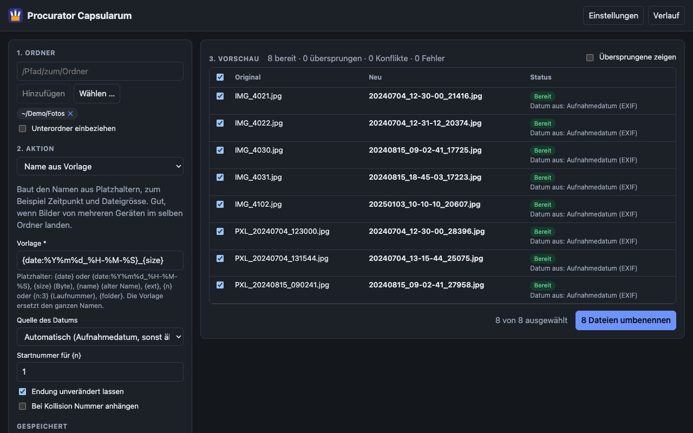
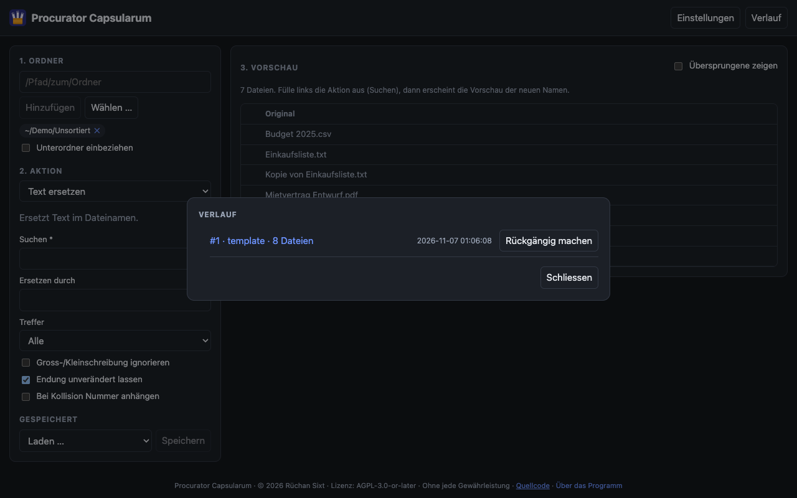
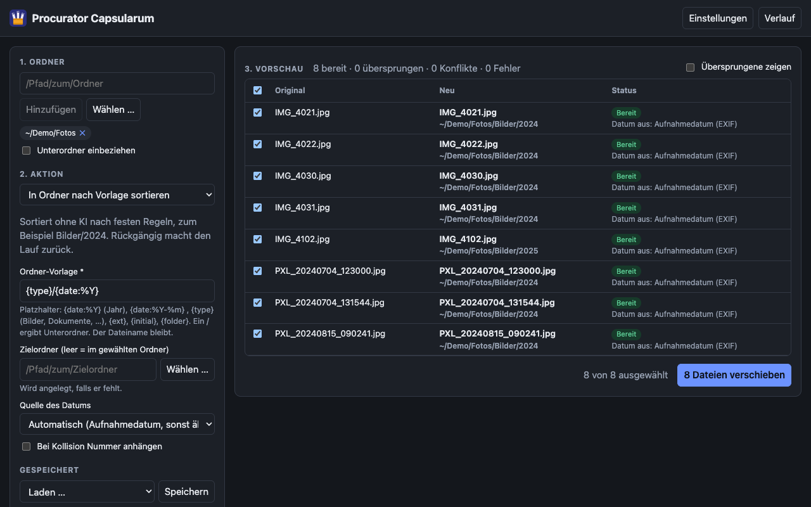
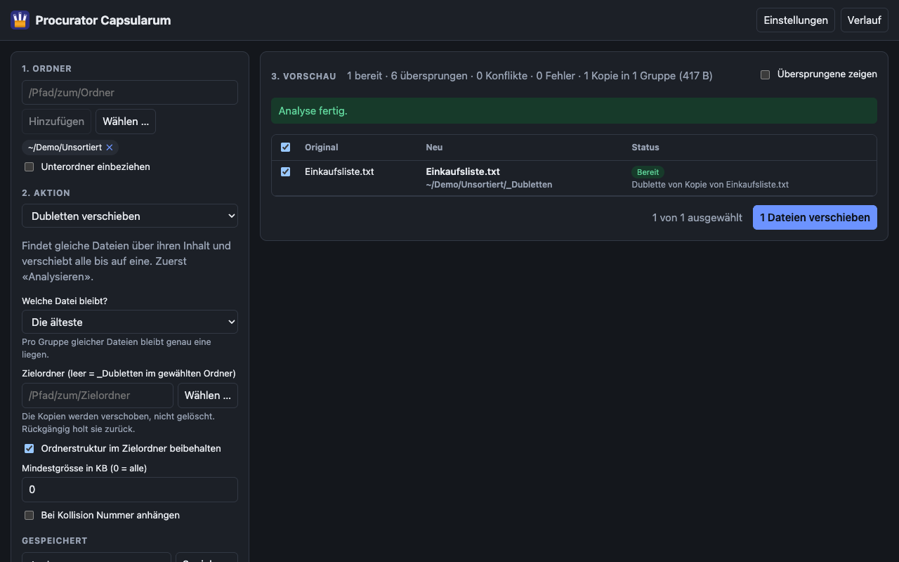
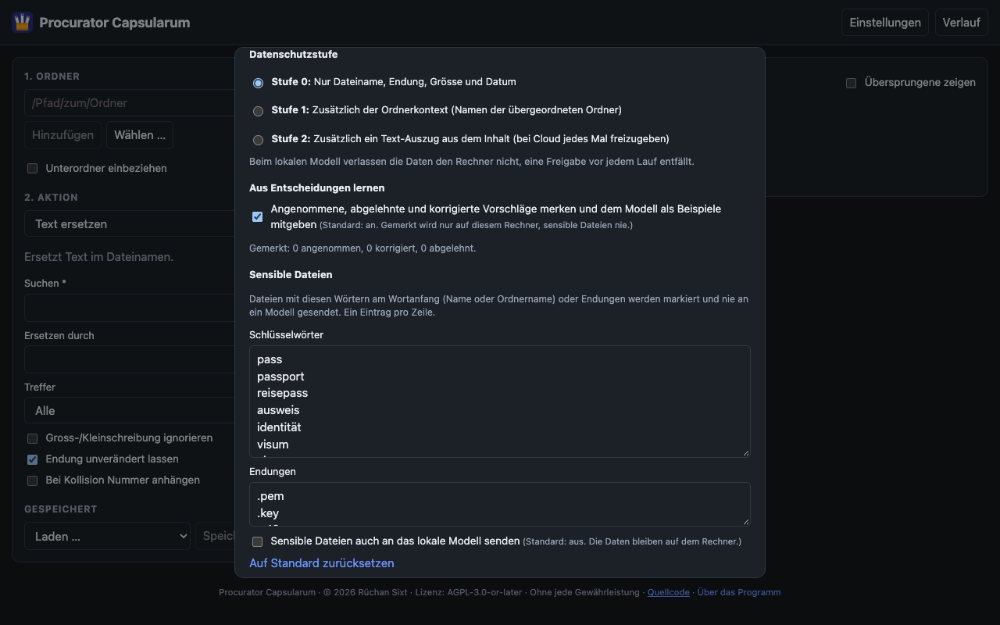
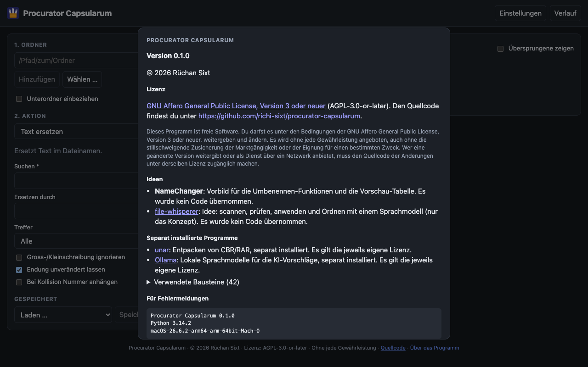

# Anleitung

Diese Anleitung erklärt, wie du mit Procurator Capsularum arbeitest, Aktion für Aktion und mit
typischen Aufgaben. Installation und Start stehen im [README](../README.md). Diese Anleitung öffnet sich auch in der App mit dem
Knopf **Hilfe** oben rechts, ohne Internet.

## Das Grundprinzip

Jede Aktion läuft in drei Schritten:

1. **Ordner und Aktion wählen.** Die Dateien erscheinen sofort in der Vorschau.
2. **Vorschau prüfen.** Pro Datei siehst du alt und neu, den Status und den Grund. Zeilen, die nicht
   betroffen sein sollen, wählst du ab.
3. **Ausführen.** Erst jetzt wird etwas verändert. Jeder Lauf steht danach im **Verlauf** und lässt sich
   rückgängig machen.

Die Vorschau verändert nie etwas. Sie rechnet bei jeder Eingabe neu.



Links wählst du Ordner und Aktion, rechts steht pro Datei das Alte, das Neue und der Status mit Grund.
Die Beispiele auf dieser Seite nutzen erfundene Demo-Dateien.

### Status in der Vorschau

| Status | Bedeutung |
|---|---|
| bereit | Die Datei wird verändert |
| übersprungen | Nichts zu tun (kein Treffer, Name schon richtig). Mit «Übersprungene zeigen» sichtbar |
| Konflikt | Der neue Name gäbe es schon, oder zwei Dateien bekämen denselben Namen. Es wird nie etwas überschrieben |
| Fehler | Nicht ausführbar, zum Beispiel fehlende Schreibrechte oder eine unbrauchbare Vorlage. Der Grund steht in der Zeile |
| 🔒 sensibel | Die Datei gilt als sensibel (siehe [Datenschutz](#datenschutz)). Sie bleibt für Modelle unsichtbar |

**Konflikte lösen:** Mit «Bei Kollision Nummer anhängen» (Kommandozeile `--force-unique`) bekommen gleiche
Namen eine Nummer. Sonst ändere die Aktion oder wähle die Zeilen ab.

### Rückgängig

Unter **Verlauf** lässt sich jeder Lauf zurücknehmen.



- Umbenennen und Verschieben: Die Dateien kommen zurück, von der Aktion angelegte **leere** Ordner werden
  wieder entfernt.
- Konvertieren: Die erzeugten Dateien werden **gelöscht**. Die Originale wurden nie verändert.
- Gelingt ein Rückgängig nur teilweise, lässt es sich nicht wiederholen. Der Verlauf zeigt, was fehlt.

## Typische Aufgaben

### Bilder von mehreren Geräten in einem Ordner umbenennen

Fotos von Handy und Kamera landen im selben Ordner und haben teils dieselbe Sekunde. Mit der Aktion
**Name aus Vorlage** bekommt jedes Bild Aufnahmezeit und Dateigrösse im Namen:

```
{date:%Y%m%d_%H-%M-%S}_{size}      →      20240704_12-30-00_2345678.jpg
```

Die Zeit stammt aus den EXIF-Angaben des Fotos. Haben zwei Dateien Zeit **und** Grösse gemeinsam, sind es
meist echte Dubletten. Sie erscheinen als Konflikt.

```bash
uv run pc rename template '{date:%Y%m%d_%H-%M-%S}_{size}' ORDNER
```

### Fotos nach Jahr und Monat sortieren

Aktion **In Ordner nach Vorlage sortieren** mit `{date:%Y}/{date:%m}` ergibt `2024/07/...`. Mit `{type}` als
erster Ebene (`{type}/{date:%Y}`) trennst du zusätzlich Bilder, Videos und Dokumente.

```bash
uv run pc sort '{type}/{date:%Y}' ORDNER --to ZIELORDNER
```



### Dubletten aufräumen

1. Aktion **Dubletten verschieben** wählen und **Analysieren** drücken (die Dateien werden gelesen, das
   dauert bei vielen Dateien).
2. In der Vorschau prüfen, welche Datei pro Gruppe liegen bleibt (älteste, neueste, kürzester Pfad oder die
   erste alphabetisch).
3. Ausführen. Die Kopien landen in `_Dubletten`, gelöscht wird nichts. Wenn alles stimmt, löschst du den
   Ordner selbst.



### Comics von CBR zu CBZ

Aktion **CBR → CBZ**, Zielordner angeben. Die Seiten bleiben bitidentisch, nur der Container ändert sich.
Dafür braucht es das Programm `unar` (`brew install unar`). Vorhandene Ziele werden übersprungen, ein
abgebrochener Lauf lässt sich also fortsetzen.

### Ordnen mit KI-Vorschlägen

Siehe [KI-Vorschläge](#ki-vorschläge).

### Eine Einstellung wiederverwenden

Unter **Gespeichert** lässt sich die ausgefüllte Aktion mit einem Namen speichern und später laden.

## Alle Aktionen

Die Kommandozeile kennt zu jeder Aktion `--help`. Ohne `--apply` zeigt sie nur die Vorschau.

### Umbenennen

Sofern nichts anderes steht, bleibt die **Endung unverändert** (Kommandozeile: `--with-ext` bearbeitet sie
mit).

| Aktion | Was sie macht | Beispiel |
|---|---|---|
| Text ersetzen | Ersten, letzten oder alle Treffer ersetzen | `pc rename replace ORDNER -f " " -t "_"` |
| Wildcard | Muster mit `*` und `?` ersetzen (erster Treffer) | `pc rename wildcard ORDNER -p "IMG_*" -t "Foto"` |
| Regulärer Ausdruck | Ersetzen mit Rückverweisen `$1`, `$2` | `pc rename regex ORDNER -p "(\d+)-(\d+)" -t "$2-$1"` |
| Anhängen, Voranstellen | Text an Ende oder Anfang des Namens | `pc rename append ORDNER -t "_alt"` |
| Zeichen entfernen | Ab Position oder am Ende | `pc rename remove ORDNER -n 4` |
| Zeichen einfügen | An einer Position einfügen oder auf Länge auffüllen | `pc rename insert ORDNER -t "0" --pad-to 5` |
| Gross-/Kleinschreibung | Titel, klein oder GROSS | `pc rename case ORDNER --mode lower` |
| Laufnummer | Nummer anhängen, voranstellen oder ersetzen. Reihenfolge nach Name, Datum (bei Fotos das Aufnahmedatum), Erstellt, Geändert oder in der Oberfläche per Ziehen | `pc rename sequence ORDNER --label Urlaub --position replace` |
| Datum | Datum einfügen, siehe unten | `pc rename date ORDNER` |
| Name aus Vorlage | Ganzen Namen aus Platzhaltern bauen, siehe unten | `pc rename template '{date}_{name}' ORDNER` |

#### Datum

Die Quelle ist standardmässig **Automatisch**: bei Fotos das Aufnahmedatum (EXIF), sonst das **ältere** von
Erstellt und Geändert. Das ist meist das echte Datum, weil Kopieren und Herunterladen das Dateidatum auf
«jetzt» setzen. Der Tag der Ausführung wird nie verwendet. Weitere Quellen: Erstellt, Geändert, eigenes Datum.
Das Format folgt `strftime` (`%Y-%m-%d`, `%Y%m%d_%H-%M-%S`), die Position ist vorn, hinten oder ersetzen. Die
Vorschau nennt pro Datei, woher das Datum kommt.

#### Name aus Vorlage

Die Vorlage ersetzt den ganzen Namen, die Endung bleibt.

| Platzhalter | Wert |
|---|---|
| `{date}` oder `{date:Format}` | Datum wie oben, Format nach `strftime` (Standard `%Y-%m-%d`) |
| `{size}` oder `{size:8}` | Dateigrösse in Byte, mit Nullen aufgefüllt |
| `{name}` | bisheriger Name ohne Endung |
| `{ext}` | Endung ohne Punkt |
| `{n}` oder `{n:3}` | Laufnummer (Start einstellbar), in natürlicher Namensreihenfolge |
| `{folder}` | Name des Ordners, in dem die Datei liegt |

Ein unbekannter Platzhalter oder lose geschweifte Klammern ergeben eine Meldung. Ein `/` im Ergebnis gibt
eine Fehlerzeile, nie einen Ordner.

### Organisieren

| Aktion | Was sie macht |
|---|---|
| In Ordner verschieben | Verschiebt in einen Zielordner, flach oder mit nachgebauter Ordnerstruktur. Der Zielordner wird angelegt, auch auf einem anderen Laufwerk (kopieren, prüfen, Original löschen) |
| In Ordner nach Vorlage sortieren | Sortiert nach festen Regeln, ohne KI. Dateiname bleibt |
| KI-Vorschläge | Ein Sprachmodell schlägt Ordner und Namen vor, siehe [KI-Vorschläge](#ki-vorschläge) |
| Dubletten verschieben | Verschiebt gleiche Dateien bis auf eine in `_Dubletten` |

#### Ordner nach Vorlage

| Platzhalter | Wert |
|---|---|
| `{date:Format}` | Datum, zum Beispiel `{date:%Y}` oder `{date:%Y-%m}` |
| `{type}` | Bilder, Videos, Audio, Dokumente, Tabellen, Präsentationen, Archive oder Sonstiges |
| `{ext}` | Endung, klein, ohne Punkt |
| `{initial}` | Anfangsbuchstabe oder erste Ziffer des Namens, gross (`#` bei Sonderzeichen) |
| `{folder}` | bisheriger Ordnername |

Ein `/` in der Vorlage ergibt Unterordner (höchstens 6 Ebenen). `..`, absolute Pfade und versteckte Ordner
werden nie angelegt. Ohne Zielordner wird im gewählten Ordner sortiert. Dateien, die schon richtig liegen,
werden übersprungen.

### Konvertieren

| Aktion | Was sie macht |
|---|---|
| CBR → CBZ | Comic-Archiv von RAR zu ZIP, Seiten bleiben bitidentisch. Optional vorhandene CBZ und PDF mitkopieren. Braucht `unar` |
| Bilder konvertieren | JPG, PNG, WebP, HEIC, TIFF und BMP nach JPG, PNG oder WebP, optional auf eine längste Seite verkleinern |

Konvertieren erzeugt **neue** Dateien (`.part`-Datei, dann umbenannt), die Originale bleiben liegen. Ohne
Zielordner liegt das Ergebnis neben der Quelle.

## KI-Vorschläge

Ein Sprachmodell schlägt pro Datei Ordner und Namen vor. Du prüfst und korrigierst in der Vorschau. Das Modell
läuft standardmässig **lokal** über [Ollama](https://ollama.com/), optional in der Cloud mit Claude.

### Ablauf

1. **Analysieren** drücken. Das Modell wird befragt (Fortschritt, Abbrechen möglich), die Vorschläge werden
   lokal gespeichert. Bekannte, unveränderte Dateien werden nicht erneut gefragt.
2. In der Vorschau prüfen. Jede Zeile hat eine Checkbox. Mit ✎ änderst du das Ziel von Hand (`Ordner/Name`).
3. Anwenden. Rückgängig wie bei jeder Aktion.

### Eigene Anweisung

Das Feld «Eigene Anweisung» (`--hint`) steuert das Ergebnis, zum Beispiel «Dokumente nach Jahr und Art
ordnen». Eine neue Anweisung gilt als neuer Lauf. «Neu berechnen» fragt auch bekannte Dateien noch einmal.

### Was geprüft wird

Vorschläge mit einem Pfad ausserhalb des gewählten Ordners, absoluten Pfaden, `..`, versteckten Ordnern oder
geänderter Endung werden nie übernommen. Sie erscheinen als Fehler.

### Lernen aus deinen Entscheidungen

Nach dem Anwenden in der Oberfläche merkt sich die App, was du **übernommen**, **abgewählt** oder **von Hand
korrigiert** hast. Bei der nächsten Analyse bekommt das Modell daraus Gewohnheiten und wenige Beispiele.

- Gemerkt wird nur auf deinem Rechner, höchstens 2000 Einträge. Sensible Dateien werden nie gemerkt.
- Bei Cloud gehen Beispiele erst ab Datenschutzstufe 1 mit und stehen in der Freigabe.
- Ausschalten: Einstellungen → «Aus Entscheidungen lernen». Ansehen und löschen: `pc learned`, `pc learned --clear`.
- `pc organize --apply` lernt nichts, weil dort die Prüfung in der Vorschau fehlt.

### Ollama einrichten

```bash
brew install ollama
ollama pull gemma4:e2b
```

Danach in den Einstellungen unter «KI-Modell» auf **Verbindung testen** drücken. Ollama muss laufen, die App
spricht es nur über `localhost` an. Kleine Modelle ordnen grob richtig, liegen aber gelegentlich daneben.
Manche Ollama-Runner (zum Beispiel MLX) unterstützen kein erzwungenes Antwortformat, dann liest das Programm
die Antwort tolerant.

### Claude (Cloud)

```bash
uv sync --extra claude
export ANTHROPIC_API_KEY=...
```

In den Einstellungen den Anbieter auf Claude stellen. Gespeichert wird nur der **Name** der Umgebungsvariable,
nie der Schlüssel. Jeder Lauf braucht eine Bestätigung, der Dialog zeigt vorher, was gesendet würde
(Kommandozeile: Rückfrage oder `--yes-cloud`).

## Datenschutz

Ohne KI-Vorschläge verlassen keine Daten den Rechner. Der Server hört nur auf `127.0.0.1`.

### Datenschutzstufen

| Stufe | Was ans Modell geht |
|---|---|
| 0 (Standard) | Dateiname, Endung, Grösse, Datum |
| 1 | zusätzlich die Namen der Ordner |
| 2 | zusätzlich ein kurzer Textauszug aus einfachen Textdateien (`.txt`, `.md`, `.csv` und ähnliche, keine PDFs) |



### Sensible Dateien

Dateien, deren Name oder Ordnername mit einem Schlüsselwort **beginnt** (zum Beispiel Pass, Steuer, Konto), und
Dateien mit bestimmten Endungen (zum Beispiel `.pem`) sind sensibel. Sie sind in der Vorschau mit 🔒 markiert
und gehen **nie** an ein Modell, auch ihre Namen nicht. Nur bei einem lokalen Modell lässt sich das in den
Einstellungen bewusst abschalten. Die Listen sind änderbar, «Auf Standard zurücksetzen» stellt sie wieder her.

```bash
uv run pc sensitive ORDNER      # zeigt, welche Dateien betroffen wären
```

## Einstellungen und Dateien

Unter **Über das Programm** (unten auf der Seite) stehen Version, Autor, Lizenz und die Lizenzen der
verwendeten Bausteine. Der Block «Für Fehlermeldungen» lässt sich in eine Fehlermeldung kopieren.



Die Einstellungen öffnest du in der Oberfläche oder per Hand in `config.toml`. Pfad: `uv run pc config`.

```toml
[ai]
provider = "ollama"               # oder "claude"
ollama_model = "gemma4:e2b"
ollama_host = "http://localhost:11434"   # nur localhost
claude_model = "claude-sonnet-5-5"
api_key_env = "ANTHROPIC_API_KEY"        # Name der Variable, nie der Schlüssel
privacy_level = 0
learn = true

[privacy]
sensitive_keywords = ["pass", "steuer", "konto", "…"]   # Standardliste gekürzt
sensitive_extensions = [".pem", ".key", "…"]            # Standardliste gekürzt
allow_sensitive_local = false
```

Konfiguration, Verlauf und Datei-Index liegen im Benutzerordner (macOS:
`~/Library/Application Support/procurator-capsularum/`), nicht im Projekt. Der Index enthält nur Pfade,
Grössen, Zeitstempel und Hashes, nie Dateiinhalte. Mit den Umgebungsvariablen `PC_CONFIG`, `PC_JOURNAL` und
`PC_INDEX` lassen sich die Orte überschreiben.

## Wenn etwas nicht klappt

| Problem | Lösung |
|---|---|
| Der Browser zeigt «Die Oberfläche ist noch nicht gebaut» | `cd web && npm install && npm run build`, dann die Seite neu laden |
| Eine Änderung an der Oberfläche kommt nicht an | Neu bauen (`npm run build`) und hart neu laden (Cmd+Shift+R) |
| «Ollama antwortet nicht» | Läuft der Dienst? In den Einstellungen «Verbindung testen». Ist das Modell geladen (`ollama list`)? |
| Cloud: «Variable ist nicht gesetzt» | `ANTHROPIC_API_KEY` in dem Terminal setzen, in dem `pc serve` gestartet wird |
| CBR-Konvertierung meldet Fehler | `unar` fehlt oder die Datei ist beschädigt (`unar -t Datei.cbr` prüft das) |
| Viele Konflikte | «Bei Kollision Nummer anhängen» einschalten oder die Aktion ändern |
| Eine Datei fehlt in der Liste | Versteckte Dateien und Ordner (mit Punkt) sowie Systemdateien wie `.DS_Store` werden ignoriert |
| Ein Lauf lässt sich nicht ganz rückgängig machen | Der Verlauf nennt die betroffenen Dateien. Ein teilweises Rückgängig lässt sich nicht wiederholen |
